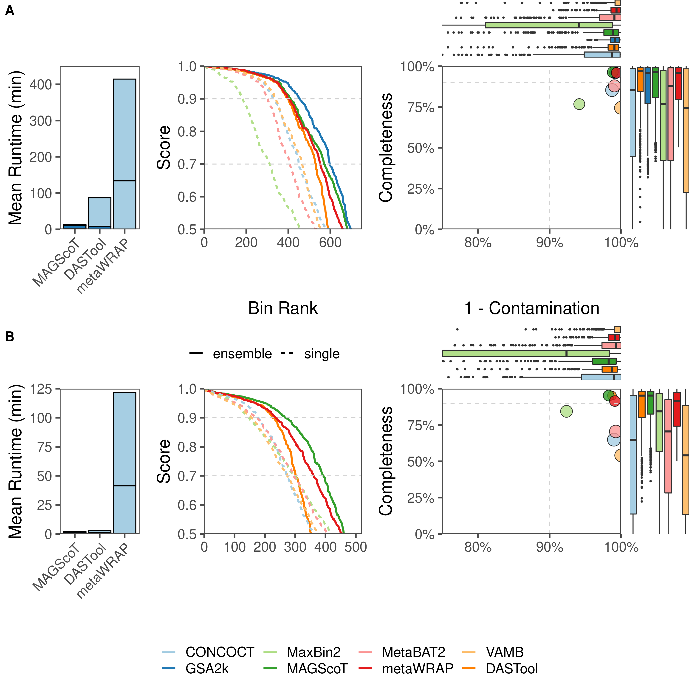

# MAGScoT

MAGScoT = MAG Scoring (and refinement) Tool. It is pronounced like "Mascot".

MAGScoT is a fast tool for scoring and refining metagenomic bins from different binning tools. It uses the GTDB-Tk release 207 (v2) marker genes to estimate the completeness and contamination of each bin, and iteratively selects the best metagenome-assembled genomes (MAGs) in a dataset. MAGScoT can also merge overlapping bins from different binners into hybrid bins and add them to the pool of candidate MAGs.

MAGScoT outperforms existing tools in computation time and resources, as well as in the quality and quantity of recovered MAGs.



### Independent benchmark

MAGScoT was evaluated independently by [Han, Wang & Zhu (2025), *Nature Communications* 16, 2865](https://www.nature.com/articles/s41467-025-57957-6). They compared DAS Tool, MetaWRAP and MAGScoT (v1.0.0) for refining the output of the top three binners across five real datasets and seven combinations of data type and binning mode. Results:

- **Bin quality:** MetaWRAP had the best average rank, and MAGScoT achieved a comparable rank. MAGScoT recovered the most near-complete MAGs overall.
- **Resources:** MAGScoT used less than 3 GB of memory, compared with about 30 GB for MetaWRAP, and MetaWRAP took more than 10 times longer.
- **Their choice:** the authors used MAGScoT's refined MAGs for all downstream analyses and include it as the bin-refinement tool in their binning wrapper suite.

### Citation

Rühlemann MC, Wacker EM, Ellinghaus D, Franke A. *MAGScoT: a fast, lightweight and accurate bin-refinement tool.* Bioinformatics 38(24), 5430–5433 (2022). Preprint: [bioRxiv](https://www.biorxiv.org/content/10.1101/2022.05.17.492251v1).

## Installation

MAGScoT needs R (≥ 3.5) with the packages `data.table` and `optparse`. To search marker genes itself (`--proteins` or `annotate`), it also needs `hmmer`, and `prodigal` for gene prediction from an assembly.

### Conda

```bash
git clone https://github.com/ikmb/MAGScoT
conda env create -f MAGScoT/environment.yml
conda activate magscot
Rscript MAGScoT/MAGScoT.R --help
```

`MAGScoT.R` is run from the cloned repository; it loads the code in `R/` and the marker data in `profiles/` and `hmm/` next to it.

### Docker

```bash
docker run --rm -v "$PWD":"$PWD" -w "$PWD" ikmb/magscot:latest \
  -i example.contigs_to_bin.tsv --hmm example.hmm
```

## Quick start

MAGScoT has three commands: `refine` (the default), `annotate` and `extract`.

If you already have proteins predicted with prodigal or pyrodigal, pass them with `--proteins`. MAGScoT then searches the marker genes with hmmsearch itself:

```bash
cd MAGScoT/example
Rscript ../MAGScoT.R -i example.contigs_to_bin.tsv --proteins example.prodigal.faa.gz \
  --threads 8 -o example --contigs example.contigs.fasta.gz
```

This writes `example.hmm` (the marker hits, reusable with `--hmm`), `example.scores.out`, `example.refined.out`, `example.refined.contig_to_bin.out`, and one FASTA file per refined bin in `example_bins/`.

Starting from the assembly alone, `annotate` predicts genes with prodigal and then searches the marker genes:

```bash
Rscript ../MAGScoT.R annotate --contigs example.contigs.fasta.gz -o example --threads 8
Rscript ../MAGScoT.R -i example.contigs_to_bin.tsv --hmm example.hmm -o example
```

## Input

### Contig-to-bin file (`-i`)

Tab-separated, no header, three columns: bin, contig, binning tool. Combine the output of all binning tools into one file, for example:

```bash
awk '{print $1"\t"$2"\tvamb"}'     example.vamb.contigs_to_bin.tsv     >  example.contigs_to_bin.tsv
awk '{print $1"\t"$2"\tconcoct"}'  example.concoct.contigs_to_bin.tsv  >> example.contigs_to_bin.tsv
awk '{print $1"\t"$2"\tmetabat2"}' example.metabat2.contigs_to_bin.tsv >> example.contigs_to_bin.tsv
awk '{print $1"\t"$2"\tmaxbin2"}'  example.maxbin2.contigs_to_bin.tsv  >> example.contigs_to_bin.tsv
```

Each binning tool may assign a contig to at most one bin. Bin names may repeat across binning tools; bins are identified by tool and name. To compare several runs of the same tool, give each run its own name in the third column.

### Marker genes (`--proteins` or `--hmm`)

Give one of:

- `--proteins`: a protein FASTA from prodigal or pyrodigal (may be gzipped). MAGScoT searches the GTDB r207 marker HMMs in it with hmmsearch and saves the hits as `<out>.hmm`.
- `--hmm`: precomputed marker hits, tab-separated, no header, three columns: protein ID, marker, e-value. `MAGScoT.R annotate` creates this file.

In both cases protein IDs must be `<contig>_<n>`, as produced by prodigal and pyrodigal. To create the marker file manually:

```bash
zcat example.contigs.fasta.gz | prodigal -p meta -a example.prodigal.faa -o /dev/null
hmmsearch --tblout example.tigr.tbl -o /dev/null --noali --notextw --cut_nc --cpu 8 \
  ../hmm/gtdbtk_rel207_tigrfam.hmm example.prodigal.faa
hmmsearch --tblout example.pfam.tbl -o /dev/null --noali --notextw --cut_nc --cpu 8 \
  ../hmm/gtdbtk_rel207_Pfam-A.hmm example.prodigal.faa
cat example.tigr.tbl example.pfam.tbl | grep -v "^#" | awk '{print $1"\t"$4"\t"$5}' > example.hmm
```

## Output

| File | Content |
|---|---|
| `<out>.scores.out` | Scores of all candidate bins (input bins and hybrid bins) |
| `<out>.refined.out` | Statistics of the refined bins, with their new name in `refined_id` |
| `<out>.refined.contig_to_bin.out` | Contig assignments of the refined bins (`binnew`, `contig`) |
| `<out>_bins/` | One FASTA file per refined bin (only with `--contigs`) |

Main columns: `Completeness` (unique markers / markers in set), `Contamination` (markers with more than one copy / unique markers), `MultiContam` (surplus copies / markers in set) and `score = a × Completeness − b × Contamination − c × MultiContam`. Each bin is scored against the bacterial (bac120) and archaeal (ar53) marker sets, and the better one is reported in `set`.

## Algorithm

1. **Scoring**: all bins are scored with the GTDB r207 marker genes.
2. **Bin merging** (unless `--skip_merge_bins`): bins with at least `--min_markers` unique markers are used as seeds. If a bin from another binning tool contains at least `--min_sharing` of the seed's markers, the two are merged into a hybrid bin. In each further iteration (`-n`), the new hybrid bins are used as seeds again. Hybrid bins with a contig set identical to an existing bin are discarded.
3. **Refinement**: the highest-scoring bin is selected, its contigs are removed from all other bins, the affected bins are re-scored, and this repeats until no bin reaches the score cutoff (`-t`). Bins below the completeness cutoff, or with a contamination above `--max_contamination`, are not considered.

## Options

```
Usage: MAGScoT.R [refine] [options]

-i, --input           Contig-to-bin file: bin, contig, binning tool (tab-separated, no header)
--hmm                 Marker file: protein id, marker, e-value (tab-separated, no header)
--proteins            Protein FASTA (prodigal/pyrodigal) instead of --hmm; runs hmmsearch
--threads             hmmsearch CPUs with --proteins [1]
-p, --profile         Marker profile: default (bac120 + ar53), bac120, ar53, or a TSV with
                      columns marker, set [default]
-o, --out             Output prefix [MAGScoT]
--bin_separator       Infix for refined bin names: <prefix>_<infix>_000001 [cleanbin]
--preset              Scoring weights: dastool (a=1, b=0.5, c=0.5) or metawrap (b=5) [dastool]
-a, --score_a         Scoring weight a (completeness); overrides the preset
-b, --score_b         Scoring weight b (contamination); overrides the preset
-c, --score_c         Scoring weight c (surplus marker copies); overrides the preset
--max_contamination   Maximum contamination (fraction, 0.1 = 10%) of considered bins;
                      1 = no filter [1]. Replaces --max_cont (still accepted)
-t, --threshold       Minimum score (and completeness) of refined bins [0.5]
--score_only          Only score the input bins
--skip_merge_bins     Skip bin merging
-m, --min_markers     Minimum unique markers of a seed bin, and of shared markers [25]
--max_marker_hits     Maximum total marker hits of a seed bin [150]
-s, --min_sharing     Minimum fraction of a seed's markers shared with the partner [0.8]
-n, --n_iterations    Number of bin-merging iterations [2]
--contigs             Assembly FASTA; write refined bins as FASTA files
--bins_dir            Directory for bin FASTA files [<out>_bins]
-q, --quiet           Suppress progress messages

Usage: MAGScoT.R annotate (--contigs <fasta> | --proteins <faa>) [-o prefix] [--threads N] [--keep_tmp]
Usage: MAGScoT.R extract -i <out>.refined.contig_to_bin.out --contigs <fasta> [-o dir]
```

### Scoring weights

The default weights (a = 1, b = 0.5, c = 0.5) are the DAS Tool defaults. `--preset metawrap` uses b = 5, following MetaWRAP's much stronger penalty on contamination (completeness − 5 × contamination). This favours cleaner bins over more complete ones. MetaWRAP uses CheckM contamination, so the preset approximates its stringency rather than reproducing MetaWRAP's choices exactly. Weights given with `-a`, `-b` or `-c` override the preset, e.g. `--preset metawrap -b 2`.

## Development

```bash
Rscript -e 'testthat::test_dir("tests/testthat")'
```

See [NEWS.md](NEWS.md) for changes between versions.

# Funding

The project was funded by the German Research Foundation (DFG) [Collaborative Research Center 1182 - Origin and Function of Metaorganisms](https://www.metaorganism-research.com/) and DFG [Research Unit 5042 - miTarget](https://www.mitarget.org/).
