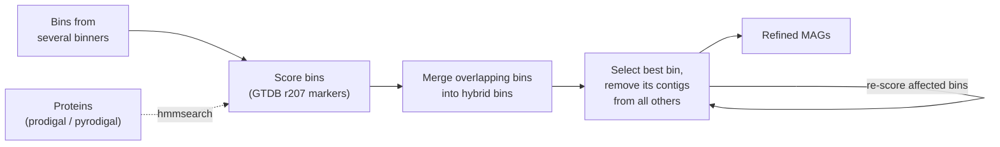

<div align="center">

# MAGScoT

**MAG Scoring and Refinement Tool** · pronounced like *"Mascot"*

Fast, lightweight refinement of metagenomic bins from multiple binning tools

[](https://github.com/ikmb/MAGScoT/actions/workflows/tests.yml)
[](https://doi.org/10.1093/bioinformatics/btac694)
[](https://hub.docker.com/r/ikmb/magscot)
[](LICENSE)

[Installation](#installation) ·
[Quick start](#quick-start) ·
[Input](#input) ·
[Output](#output) ·
[How it works](#how-it-works) ·
[Options](#options) ·
[Citation](#citation)

</div>

---

MAGScoT combines the bins of several binning tools (e.g. MetaBAT 2, VAMB, SemiBin, CONCOCT) into one non-redundant set of high-quality metagenome-assembled genomes (MAGs).

- 🧬 **Marker-based scoring:** completeness and contamination are estimated from the 120 bacterial and 53 archaeal GTDB r207 single-copy marker genes.
- 🔀 **Hybrid bins:** overlapping bins from different binners are merged into new candidate bins.
- ⚡ **Fast and lean:** refinement takes minutes and a few GB of memory, even for large datasets.
- 📦 **One command from proteins to MAGs:** give prodigal or pyrodigal proteins and get refined bins as FASTA files.

<p align="center"></p>

### Independent benchmark

MAGScoT was evaluated independently by [Han, Wang & Zhu (2025), *Nature Communications* 16, 2865](https://www.nature.com/articles/s41467-025-57957-6). They compared DAS Tool, MetaWRAP and MAGScoT (v1.0.0) for refining the output of the top three binners, across five real datasets and seven combinations of data type and binning mode.

| | DAS Tool | MetaWRAP | MAGScoT |
|---|:---:|:---:|:---:|
| Overall rank (MQ, NC and HQ MAGs) | | best | comparable to MetaWRAP |
| Near-complete MAGs | | | **most** |
| Memory | < 3 GB | ~30 GB | **< 3 GB** |
| Runtime | fast | > 10× slower | **fast** |

The authors used MAGScoT's refined MAGs for all downstream analyses and included it as the bin-refinement tool in their binning wrapper suite.

## Installation

MAGScoT needs **R ≥ 3.5** with `data.table` and `optparse`. To search marker genes itself (`--proteins` or `annotate`), it also needs **HMMER**, plus **prodigal** for gene prediction from an assembly.

**Conda**

```bash
git clone https://github.com/ikmb/MAGScoT
conda env create -f MAGScoT/environment.yml
conda activate magscot
Rscript MAGScoT/MAGScoT.R --help
```

`MAGScoT.R` runs from the cloned repository. It loads the code in `R/` and the marker data in `profiles/` and `hmm/` next to it.

**Docker**

```bash
docker run --rm -v "$PWD":"$PWD" -w "$PWD" ikmb/magscot:latest \
  -i contigs_to_bin.tsv --proteins proteins.faa --preset metawrap --max_contamination 0.05
```

## Quick start

MAGScoT has three commands: **`refine`** (the default), **`annotate`** and **`extract`**.

**From predicted proteins** (prodigal or pyrodigal). MAGScoT runs hmmsearch itself:

```bash
cd MAGScoT/example
Rscript ../MAGScoT.R -i example.contigs_to_bin.tsv \
  --proteins example.prodigal.faa.gz --threads 8 \
  --contigs example.contigs.fasta.gz -o example \
  --preset metawrap --max_contamination 0.05
```

**From the assembly only.** `annotate` predicts genes with prodigal first:

```bash
Rscript ../MAGScoT.R annotate --contigs example.contigs.fasta.gz -o example --threads 8
Rscript ../MAGScoT.R -i example.contigs_to_bin.tsv --hmm example.hmm -o example \
  --preset metawrap --max_contamination 0.05
```

> [!TIP]
> **Recommended settings:** `--preset metawrap --max_contamination 0.05`. These weight contamination strongly when ranking bins and discard bins with more than 5% contamination. The defaults (DAS Tool weights, no contamination filter) are kept so that existing pipelines give the same results.

## Input

### Contig-to-bin file (`-i`)

Tab-separated, no header, three columns: **bin**, **contig**, **binning tool**.

```
metabat2_bin.12    contig_20    metabat2
vamb_bin_7         contig_20    vamb
```

Combine the output of all binning tools into one file, for example:

```bash
awk '{print $1"\t"$2"\tvamb"}'     example.vamb.contigs_to_bin.tsv     >  example.contigs_to_bin.tsv
awk '{print $1"\t"$2"\tconcoct"}'  example.concoct.contigs_to_bin.tsv  >> example.contigs_to_bin.tsv
awk '{print $1"\t"$2"\tmetabat2"}' example.metabat2.contigs_to_bin.tsv >> example.contigs_to_bin.tsv
awk '{print $1"\t"$2"\tmaxbin2"}'  example.maxbin2.contigs_to_bin.tsv  >> example.contigs_to_bin.tsv
```

Each binning tool may assign a contig to at most one bin. Bin names may repeat across tools, because bins are identified by tool and name. To compare several runs of the same tool, give each run its own name in the third column.

### Marker genes (`--proteins` or `--hmm`)

| Option | Input |
|---|---|
| `--proteins` | Protein FASTA from prodigal or pyrodigal (may be gzipped). MAGScoT searches the GTDB r207 marker HMMs with hmmsearch and saves the hits as `<out>.hmm`. |
| `--hmm` | Precomputed marker hits: tab-separated, no header, three columns (protein ID, marker, e-value). Created by `MAGScoT.R annotate`. |

Protein IDs must be `<contig>_<n>`, as produced by prodigal and pyrodigal.

<details>
<summary>Creating the marker file manually</summary>

```bash
zcat example.contigs.fasta.gz | prodigal -p meta -a example.prodigal.faa -o /dev/null
hmmsearch --tblout example.tigr.tbl -o /dev/null --noali --notextw --cut_nc --cpu 8 \
  ../hmm/gtdbtk_rel207_tigrfam.hmm example.prodigal.faa
hmmsearch --tblout example.pfam.tbl -o /dev/null --noali --notextw --cut_nc --cpu 8 \
  ../hmm/gtdbtk_rel207_Pfam-A.hmm example.prodigal.faa
cat example.tigr.tbl example.pfam.tbl | grep -v "^#" | awk '{print $1"\t"$4"\t"$5}' > example.hmm
```

</details>

## Output

| File | Content |
|---|---|
| `<out>.refined.out` | Statistics of the refined bins; new names in `refined_id` |
| `<out>.refined.contig_to_bin.out` | Contig assignments of the refined bins (`binnew`, `contig`) |
| `<out>_bins/*.fasta` | One FASTA file per refined bin (with `--contigs`) |
| `<out>.scores.out` | Scores of all candidate bins (input and hybrid bins) |
| `<out>.hmm` | Marker hits (with `--proteins`); reuse with `--hmm` |

<details>
<summary>Score columns</summary>

| Column | Meaning |
|---|---|
| `Completeness` | unique markers / markers in the set |
| `Contamination` | markers present in more than one copy / unique markers |
| `MultiContam` | surplus marker copies / markers in the set |
| `score` | a × Completeness − b × Contamination − c × MultiContam |
| `set` | marker set (bac120 or ar53) that gave the higher score |

</details>

## How it works



1. **Scoring.** Every bin is scored against the bacterial and archaeal marker sets.
2. **Bin merging** (skip with `--skip_merge_bins`). Bins with at least `--min_markers` unique markers are used as seeds. If a bin from another binning tool contains at least `--min_sharing` of a seed's markers, the two are merged into a hybrid bin. Each further iteration (`-n`) uses the new hybrid bins as seeds. Hybrid bins identical to an existing bin are discarded.
3. **Refinement.** The highest-scoring bin is selected and its contigs are removed from all other bins. The affected bins are re-scored, and this repeats until no bin reaches the score cutoff (`-t`). Bins below the completeness cutoff or above `--max_contamination` are not considered.

### Scoring weights

| Preset | a (completeness) | b (contamination) | c (surplus copies) |
|---|:---:|:---:|:---:|
| `dastool` (default) | 1 | 0.5 | 0.5 |
| `metawrap` (recommended) | 1 | **5** | 0.5 |

`metawrap` follows MetaWRAP's much stronger penalty on contamination (completeness − 5 × contamination) and favours cleaner bins over more complete ones. MetaWRAP uses CheckM contamination, so the preset approximates MetaWRAP's stringency rather than reproducing its choices exactly. `-a`, `-b` and `-c` override the preset, e.g. `--preset metawrap -b 2`.

## Options

<details open>
<summary><b><code>refine</code></b> (default command)</summary>

| Option | Description | Default |
|---|---|---|
| `-i`, `--input` | Contig-to-bin file: bin, contig, binning tool | required |
| `--proteins` | Protein FASTA (prodigal / pyrodigal); runs hmmsearch | one of these two |
| `--hmm` | Precomputed marker hits | one of these two |
| `--threads` | hmmsearch CPUs (with `--proteins`) | 1 |
| `-o`, `--out` | Output prefix | `MAGScoT` |
| `--contigs` | Assembly FASTA; write refined bins as FASTA files | |
| `--bins_dir` | Directory for bin FASTA files | `<out>_bins` |
| `--preset` | Scoring weights: `dastool` or `metawrap` | `dastool` |
| `-a`, `-b`, `-c` | Individual scoring weights; override the preset | |
| `--max_contamination` | Maximum contamination (fraction, 0.1 = 10%) of considered bins; 1 = no filter. Replaces `--max_cont`, which is still accepted | 1 |
| `-t`, `--threshold` | Minimum score (and completeness) of refined bins | 0.5 |
| `-p`, `--profile` | Marker profile: `default` (bac120 + ar53), `bac120`, `ar53`, or a TSV with columns `marker`, `set` | `default` |
| `--skip_merge_bins` | Skip bin merging | |
| `-n`, `--n_iterations` | Number of bin-merging iterations | 2 |
| `-m`, `--min_markers` | Minimum unique markers of a seed bin, and of shared markers | 25 |
| `-s`, `--min_sharing` | Minimum fraction of a seed's markers found in the partner bin | 0.8 |
| `--max_marker_hits` | Maximum total marker hits of a seed bin | 150 |
| `--score_only` | Only score the input bins | |
| `--bin_separator` | Infix of refined bin names: `<out>_<infix>_000001` | `cleanbin` |
| `-q`, `--quiet` | Suppress progress messages | |

</details>

<details>
<summary><b><code>annotate</code></b> and <b><code>extract</code></b></summary>

```
MAGScoT.R annotate (--contigs <fasta> | --proteins <faa>) [-o prefix] [--threads N] [--keep_tmp]
MAGScoT.R extract -i <out>.refined.contig_to_bin.out --contigs <fasta> [-o dir]
```

</details>

## Citation

If you use MAGScoT, please cite:

> Rühlemann MC, Wacker EM, Ellinghaus D, Franke A. **MAGScoT: a fast, lightweight and accurate bin-refinement tool.** *Bioinformatics* 38(24), 5430–5433 (2022). [doi:10.1093/bioinformatics/btac694](https://doi.org/10.1093/bioinformatics/btac694)

## Development

```bash
Rscript -e 'testthat::test_dir("tests/testthat")'
```

Changes between versions are listed in [NEWS.md](NEWS.md).

## Funding

The project was funded by the German Research Foundation (DFG): [Collaborative Research Center 1182 – Origin and Function of Metaorganisms](https://www.metaorganism-research.com/) and [Research Unit 5042 – miTarget](https://www.mitarget.org/).
